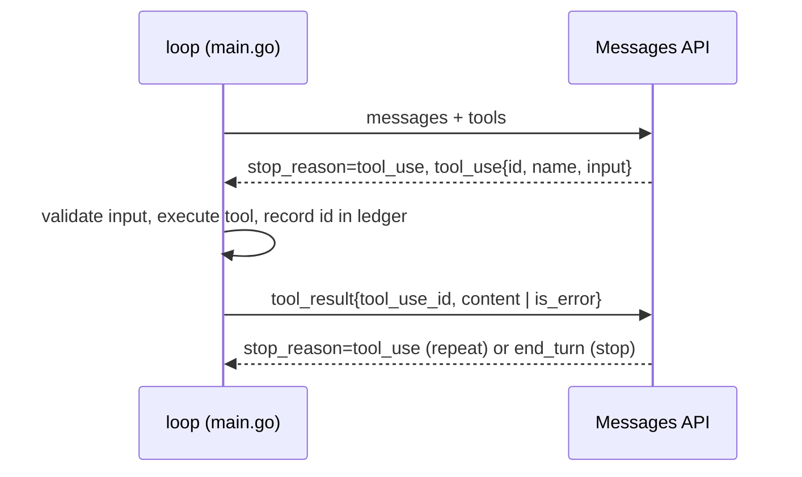

# agent-loop-go

[](https://github.com/bayanovea/agent-loop-go/actions/workflows/ci.yml)

A tool-use loop over the Anthropic Messages API, written by hand in one Go file to see the wire
format and the cost of every turn. It is not a framework and not a library. Two fake tools
(`list_tasks`, `log_time`) act on an in-memory list of tasks. The loop sends the conversation,
runs whatever the model asks for, appends the `tool_result` blocks, and repeats until
`stop_reason` says it is done. Every turn prints the stop reason, the token counts and the running
cost. The measurements and what they taught me are in [RESULTS.md](RESULTS.md).

## One turn



The loop switches on `stop_reason` explicitly, so `max_tokens`, `refusal` and `pause_turn` are
reported instead of being mistaken for a normal end. A turn budget bounds runaway tool calls.

## Run it

You need Go 1.24 or newer and credentials from `ant auth login` (the SDK picks up the profile; no
API key in the environment is needed). One run costs about half a cent on Claude Haiku 4.5.

```sh
git clone https://github.com/bayanovea/agent-loop-go && cd agent-loop-go
go run .
go test ./...
```

The prompt is fixed in `main.go`: log 30 minutes to the database migration task, then log one
more hour. The test does not touch the network.

## What I measured

A pre-registered estimate of the token cost landed within 14% of the real total, and that was
luck: the fixed base per turn was twice the guess and the growth per turn was half of it, so two
large errors cancelled ([RESULTS.md: where the estimate broke](RESULTS.md#where-the-pre-registered-estimate-broke)).
Across four turns the same conversation was billed 3.3 times, because the whole history is re-sent
every turn; this is the lever prompt caching pulls in a real agent
([the re-send multiplier](RESULTS.md#the-re-send-multiplier-observed)).
`log_time` adds a delta and is therefore not idempotent. A ledger keyed by `tool_use.id` makes a
transport replay return the same bytes, and a test pins that. It cannot catch the model asking
again with a new id; only a declarative tool can
([where to fix the double-count](RESULTS.md#where-to-fix-the-double-count-in-log_time)).
The schema says `"minimum": 1`, but without `strict: true` the API does not enforce it, so the
handler validates every field itself ([fixed during review](RESULTS.md#fixed-during-review)).

## Known gaps

The `comment` field is accepted and then discarded. `tasks` has no mutex, which is fine only
because tool calls run sequentially. Thinking and `effort` are wired in but commented out, so the
measured run has no thinking tokens. See [RESULTS.md](RESULTS.md#known-gaps).

## License

MIT.
